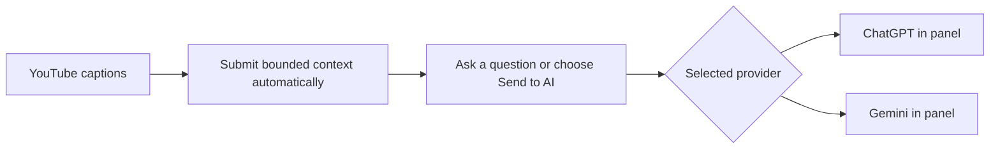

# Watch Better


[](https://github.com/wasely/watch-better/releases/download/v0.1.0/watchbetter-0.1.0-chrome.zip)
[](https://discord.gg/dpx3RhJM9)
[](LICENSE)
[](https://github.com/wasely/watch-better/actions/workflows/ci.yml)

Watch Better is a Chrome extension for quick YouTube caption briefings, searchable
transcripts, signed-in AI analysis, and Smart Skip. Preview a video from its thumbnail,
find timestamped moments, ask ChatGPT or Gemini, and jump
past high-confidence sponsors, intros, outros, repetition, and rambling without losing
your place. Detach the exact panel into a movable card while you keep browsing.

<p align="center">
  <a href="#install-in-chrome">Install</a> ·
  <a href="#see-it-work">See it work</a> ·
  <a href="#how-it-compares">Compare</a> ·
  <a href="#development">Build</a>
</p>

## Install in Chrome

Watch Better supports Chrome 133 or newer on desktop Windows, macOS, Linux, and
ChromeOS. The same extension package works across those operating systems. Chrome
for Android and iOS does not install Chrome extensions.

1. Download `watchbetter-0.1.0-chrome.zip` from the
   [latest release](https://github.com/wasely/watch-better/releases/latest).
2. Extract the ZIP somewhere you will keep it.
3. Open `chrome://extensions` in Chrome.
4. Turn on **Developer mode**.
5. Choose **Load unpacked**, then select the extracted folder containing
   `manifest.json`.
6. Pin **Watch Better** and open a YouTube video with captions.

Keep the extracted folder in place. Chrome needs it to run the extension.

## See it work

These demos play and loop directly on GitHub.

### 1. Send only the useful context

Choose transcript rows and send them when you are ready.


### 2. Ask beside the video

Continue in ChatGPT or Gemini without losing the video.


## Preview


## Features

- Press **Quick Learn** on any captioned video or Short thumbnail to open a movable
  Watch Better card with embedded Gemini and transcript context ready for questions.
- Load every caption track exposed by the current YouTube video.
- Search timestamped rows and jump directly to matching moments.
- Select specific transcript lines or use the bounded full transcript.
- Auto-submit bounded video context to the selected Ask provider, then focus its empty
  composer for your question when Ask opens.
- Use ChatGPT and Gemini inside the panel with your signed-in sessions.
- Start Smart Skip immediately with local cuts, then add high-confidence semantic cuts
  for repetition, buried tangents, housekeeping, sponsors, intros, and outros.
- Review a visual cut map, disable individual cuts, or undo the latest skip instantly.
- Detach the exact video/AI session into a draggable card inside the same YouTube
  page—never a new tab or window.
- Keep multiple detached cards alive while the normal rail panel starts fresh for
  each newly opened video.
- Switch between light and dark themes, resize the panel, or collapse it to a launcher.
- Configure transcript behavior, default tab, caching, and appearance from one settings page.
- Keep Smart Skip results only for the current browser session.

## Why use Watch Better?

Long videos often contain useful material wrapped in sponsorships, repeated points,
and long introductions. Watch Better helps you find the useful moments, ask focused
questions, and skip high-confidence filler without replacing YouTube's player.

| Task                   | Common manual workflow                       | Watch Better                                                  |
| ---------------------- | -------------------------------------------- | ------------------------------------------------------------- |
| Find the useful moment | Scrub the video or scan a long transcript    | Search timestamped rows and jump straight to the video moment |
| Prepare AI context     | Copy and clean a large transcript by hand    | Select exact rows or use the bounded full transcript          |
| Ask a provider         | Switch between YouTube and a separate AI tab | Keep ChatGPT or Gemini beside the video, in the page          |
| Connect AI             | Configure another service or API workflow    | Use your existing signed-in provider session; no API key      |
| Control sharing        | Manually paste and clean context             | Context loads automatically; you submit each actual question  |

### How it compares

This is a workflow comparison, not a claim that one tool fits everybody.

|                          | Watch Better                            | YouTube alone           | Glasp YouTube Summary              | NoteGPT                       |
| ------------------------ | --------------------------------------- | ----------------------- | ---------------------------------- | ----------------------------- |
| Main job                 | Find moments, select context, then ask  | Watch and read captions | Generate transcripts and summaries | Turn video links into notes   |
| Works beside the video   | Yes                                     | Yes                     | Yes                                | Separate web workspace        |
| Jump from transcript     | Yes                                     | Yes                     | Yes                                | Available in transcript tools |
| Choose exact rows for AI | Yes                                     | No built-in AI handoff  | Not advertised                     | Not advertised                |
| AI interface in panel    | ChatGPT and Gemini                      | No                      | Summary tools and AI integrations  | Built-in AI workspace         |
| API key needed           | No—uses your signed-in provider session | No                      | No for the extension               | No for the web app            |

“Not advertised” means we could not verify the feature on the product's public page;
it does not mean the feature can never exist. Checked August 2026 using the official
[YouTube transcript guide](https://support.google.com/youtube/answer/15930243),
[Glasp YouTube Summary page](https://glasp.co/youtube-summary?lang=en), and
[NoteGPT product overview](https://help.notegpt.io/what-is-notegpt).



## How Ask works

1. Sign in on the provider's official website if needed.
2. Watch Better preloads the selected provider and submits bounded video context with
   instructions to reply only `READY`.
3. Open **Ask**, type into the focused empty composer, and submit normally.
4. Optionally select transcript rows and choose **Send to AI** for a focused handoff.
5. Continue the conversation using the provider's own interface.
6. Use the header detach button to turn that exact panel into a movable card. Drag
   its header anywhere in YouTube; the normal rail gets a fresh panel for the next
   video. Detach again to keep multiple cards.

ChatGPT and Gemini both run inside Watch Better. Provider interfaces can change
without notice, so their adapters may occasionally need updates.

## Development

Requires Node.js 22+ and npm 10+.

```bash
npm ci
npm run build
```

Load `.output/chrome-mv3/` from `chrome://extensions`.

Other useful commands:

```bash
npm run dev
npm run dev:harness
npm run zip
npm run validate
```

`npm run validate` checks formatting, lint, TypeScript, all tests, and the
production extension build. `npm run zip` creates the install archive in `.output/`.

## Permissions

| Permission or host      | Purpose                                                                              |
| ----------------------- | ------------------------------------------------------------------------------------ |
| `storage`               | Save settings, optional session transcripts, and embedded-frame routing IDs.         |
| `declarativeNetRequest` | Permit one prepared provider subframe in a YouTube panel or detached workspace.      |
| `webNavigation`         | Verify the registered provider is Watch Better's direct child before prompt routing. |
| `youtube.com`           | Add Quick Learn to listings, mount the panel, and read on-demand captions.           |
| `chatgpt.com`           | Prefill and use its signed-in composer when ChatGPT is selected in Ask.              |
| `gemini.google.com`     | Use signed-in Gemini inside Ask and the in-page Quick Learn card.                    |

Watch Better has no cookie, browsing-data, broad host, or remote-code permission.

## Privacy

Watch Better stores no API keys and sends no analytics. Transcripts and conversations
are not persisted by default. The optional browser-session transcript cache is bounded
and cleared with the browser session. Detached cards stay only in the current YouTube
tab and browser memory. Quick Learn fetches captions only after its thumbnail button
is pressed, then sends bounded timestamped context to Gemini embedded in its in-page card.
Ask automatically submits bounded context to the selected
provider with a `READY`-only instruction; the provider applies its own account,
retention, and usage policies. Smart Skip starts locally. When enabled and
captions load, it automatically sends bounded caption chunks to the selected provider
for an isolated deep analysis. Maps last only for the browser session.

See [PRIVACY.md](PRIVACY.md) and [SECURITY.md](SECURITY.md).

## Project map

```text
watch-better/
├── src/
│   ├── entrypoints/       # YouTube, popup, settings, background, provider scripts
│   ├── features/
│   │   ├── transcript/    # Search, select, copy, and seek
│   │   ├── ask/           # Provider choice and prompt flow
│   │   ├── settings/      # User preferences
│   │   ├── detach/        # Movable in-page per-video cards
│   │   └── smart-skip/    # AI classification, cut map, cache, and playback engine
│   ├── services/          # Clipboard and signed-in web-chat adapters
│   ├── storage/           # Settings and bounded transcript cache
│   └── components/        # Shared extension UI
├── harness/               # Isolated UI scenarios
├── docs/                  # Architecture, decisions, release notes, and media
├── design-system/         # Visual system source of truth
├── package.json           # Commands and dependencies
└── wxt.config.ts          # Chrome extension configuration
```

## Current limits

- Chrome 133+ desktop YouTube watch pages and Shorts; no live streams or mobile Chrome
  extension support.
- Smart Skip uses available caption tracks only; there is no speech-to-text fallback.
- Smart Skip starts locally with the video. Optional deep cuts require the selected
  signed-in provider, but provider failure never delays or disables local skipping.
- Provider web interfaces and embedded sign-in rules can change.

## Contributing

See [CONTRIBUTING.md](CONTRIBUTING.md). Chrome Web Store preparation is tracked in
[docs/CHROME_WEB_STORE.md](docs/CHROME_WEB_STORE.md). For questions and feedback,
[join the Watch Better Discord](https://discord.gg/dpx3RhJM9).

## License

Watch Better is available under the [MIT License](LICENSE).
