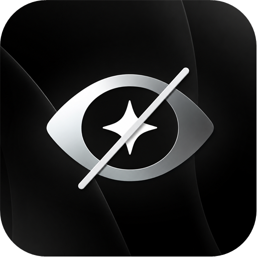
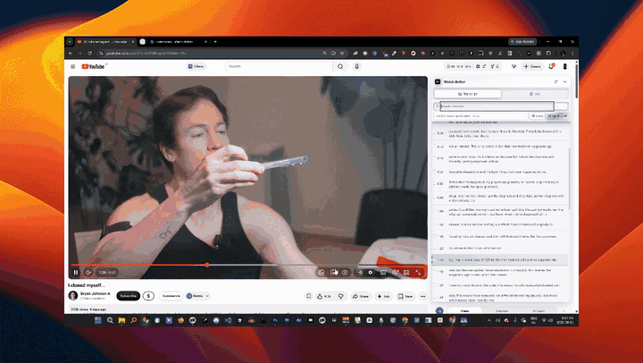
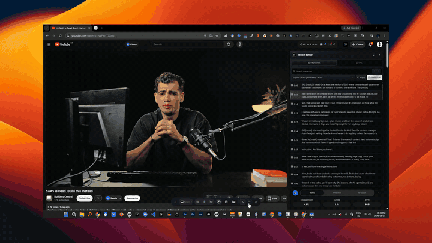
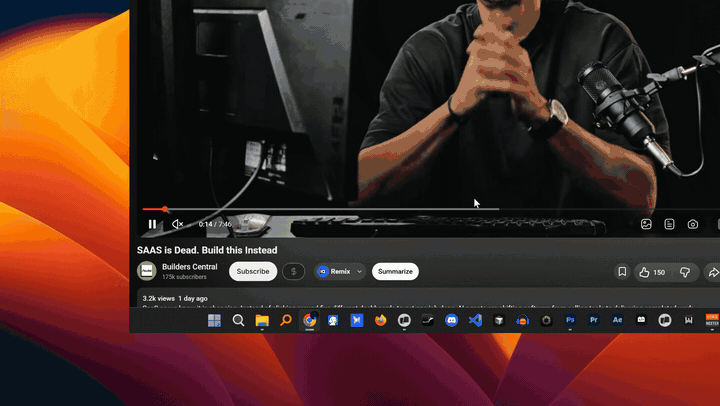
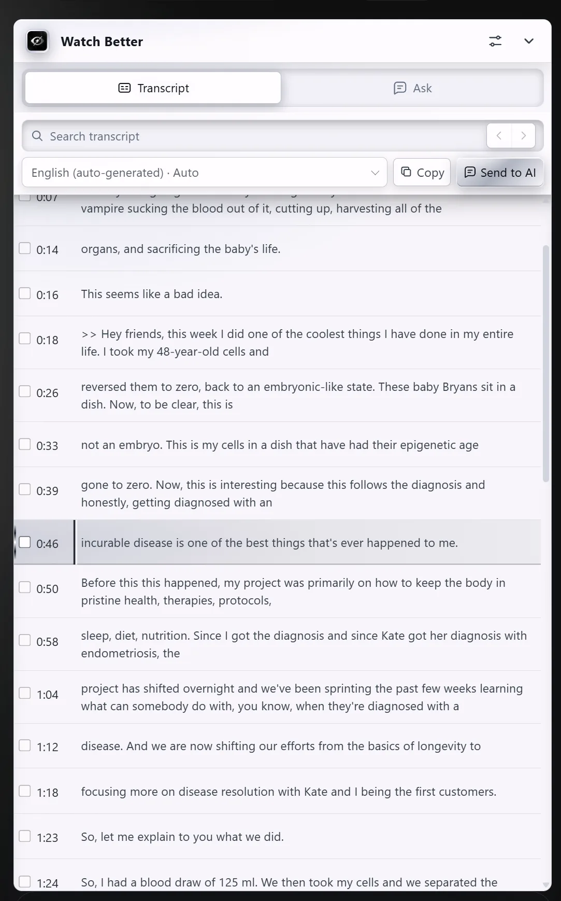
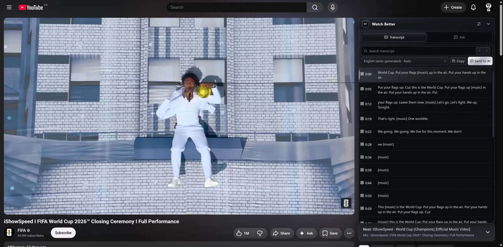
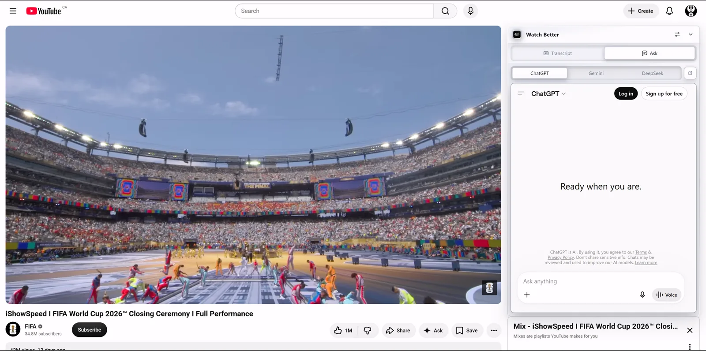
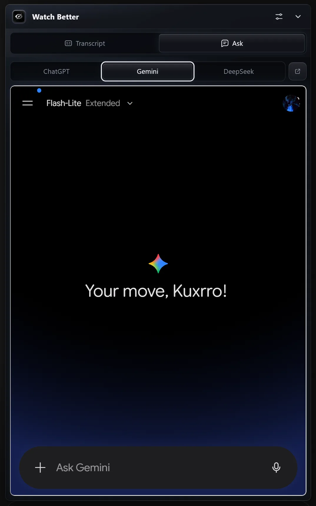
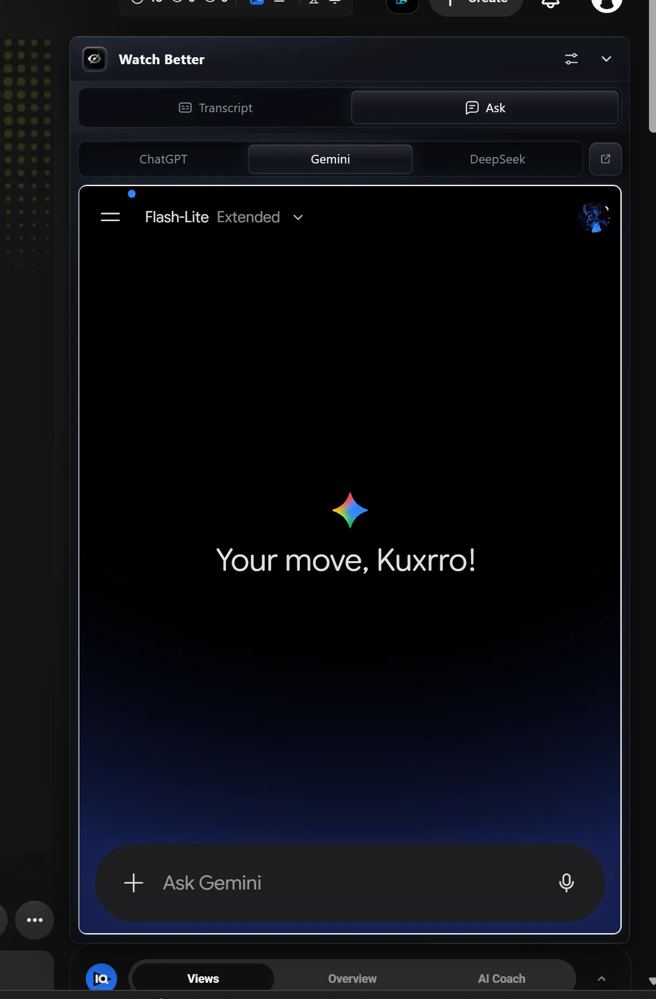
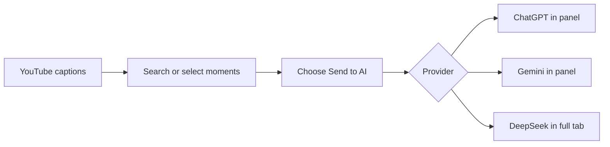

# Watch Better

[](https://github.com/wasely/watch-better/actions/workflows/ci.yml)

<p align="center">
  
</p>

Watch Better is a Chrome extension for finding useful moments in YouTube videos and
asking better questions about them. The transcript, timestamps, and your preferred AI
stay beside the video, so you spend less time scrubbing, copying, and changing tabs.

## Live demos

These demos play and loop directly on GitHub.

### 1. Search and navigate the transcript



### 2. Select context and send it to AI



### 3. Continue with a grounded answer



## Screenshots

| Light transcript panel                                                                         | Dark transcript panel                                                                            |
| ---------------------------------------------------------------------------------------------- | ------------------------------------------------------------------------------------------------ |
|     |         |
| **ChatGPT inside Ask**                                                                         | **Gemini inside Ask**                                                                            |
|                 |  |
| **Gemini with YouTube context**                                                                |                                                                                                  |
|  |                                                                                                  |

## Features

- Load every caption track exposed by the current YouTube video.
- Search timestamped rows and jump directly to matching moments.
- Select specific transcript lines or use the bounded full transcript.
- Copy captions or send context only after an explicit action.
- Use ChatGPT and Gemini inside the panel with your signed-in sessions.
- Open DeepSeek in a normal tab because its security challenge blocks embedded pages.
- Switch between light and dark themes, resize the panel, or collapse it to a launcher.
- Configure transcript behavior, default tab, caching, and appearance from one settings page.

## Why use Watch Better?

Long videos often contain a few minutes you actually need. Watch Better helps you find
those minutes, choose the exact context, and ask a focused question without turning the
video into another tab-management job.

| Task                   | Common manual workflow                       | Watch Better                                                         |
| ---------------------- | -------------------------------------------- | -------------------------------------------------------------------- |
| Find the useful moment | Scrub the video or scan a long transcript    | Search timestamped rows and jump straight to the video moment        |
| Prepare AI context     | Copy and clean a large transcript by hand    | Select exact rows or use the bounded full transcript                 |
| Ask a provider         | Switch between YouTube and a separate AI tab | Keep ChatGPT or Gemini beside the video; use a prepared DeepSeek tab |
| Connect AI             | Configure another service or API workflow    | Use your existing signed-in provider session; no API key             |
| Control sharing        | Manually track what was pasted               | Nothing is sent until you choose **Send to AI**                      |

### How it compares

This is a workflow comparison, not a claim that one tool fits everybody.

|                          | Watch Better                            | YouTube alone           | Glasp YouTube Summary              | NoteGPT                       |
| ------------------------ | --------------------------------------- | ----------------------- | ---------------------------------- | ----------------------------- |
| Main job                 | Find moments, select context, then ask  | Watch and read captions | Generate transcripts and summaries | Turn video links into notes   |
| Works beside the video   | Yes                                     | Yes                     | Yes                                | Separate web workspace        |
| Jump from transcript     | Yes                                     | Yes                     | Yes                                | Available in transcript tools |
| Choose exact rows for AI | Yes                                     | No built-in AI handoff  | Not advertised                     | Not advertised                |
| AI interface in panel    | ChatGPT and Gemini                      | No                      | Summary tools and AI integrations  | Built-in AI workspace         |
| DeepSeek workflow        | Prepared prompt opens in a normal tab   | No                      | Not advertised                     | Not advertised                |
| API key needed           | No—uses your signed-in provider session | No                      | No for the extension               | No for the web app            |

“Not advertised” means we could not verify the feature on the product's public page;
it does not mean the feature can never exist. Checked August 2026 using the official
[YouTube transcript guide](https://support.google.com/youtube/answer/15930243),
[Glasp YouTube Summary page](https://glasp.co/youtube-summary?lang=en), and
[NoteGPT product overview](https://help.notegpt.io/what-is-notegpt).



## How Ask works

1. Open **Ask** and choose ChatGPT, Gemini, or DeepSeek. Nothing is sent yet.
2. Sign in on the provider's official website if needed.
3. In **Transcript**, optionally select the rows you want to reference.
4. Choose **Send to AI**. With no selection, Watch Better sends the bounded transcript.
5. Continue the conversation using the provider's own interface.

ChatGPT and Gemini run inside Watch Better. DeepSeek opens in a full tab. Provider
interfaces can change without notice, so their adapters may occasionally need updates.

## Install in Chrome

No programming or developer tools required.

1. Open the [latest Watch Better release](https://github.com/wasely/watch-better/releases/latest).
2. Download `watchbetter-0.1.0-chrome.zip`.
3. Extract the ZIP to a folder you will keep.
4. In Chrome, open `chrome://extensions`.
5. Turn on **Developer mode** in the top-right corner.
6. Choose **Load unpacked** and select the extracted folder containing `manifest.json`.
7. Pin **Watch Better**, then open a YouTube video with captions.

Chrome may remove the extension if you delete or move the extracted folder. Keep that
folder in place after installation.

### Build from source

Requires Node.js 22+ and npm 10+.

```bash
npm ci
npm run build
```

Load `.output/chrome-mv3/` from `chrome://extensions`.

To create a distributable archive:

```bash
npm run zip
```

The ZIP is written to `.output/watchbetter-0.1.0-chrome.zip`.

## Development

```bash
npm run dev
npm run dev:harness
npm run validate
```

`npm run validate` checks formatting, lint, TypeScript, all tests, and the
production extension build.

## Permissions

| Permission or host      | Purpose                                                                            |
| ----------------------- | ---------------------------------------------------------------------------------- |
| `storage`               | Save settings, optional session transcripts, and embedded-frame routing IDs.       |
| `declarativeNetRequest` | Permit one prepared provider subframe in the current YouTube tab while needed.     |
| `webNavigation`         | Verify the registered provider is the panel's direct child before routing prompts. |
| `youtube.com`           | Mount Watch Better and read captions exposed by the current watch page.            |
| `chatgpt.com`           | Use the signed-in composer after an explicit send action.                          |
| `gemini.google.com`     | Use the signed-in composer after an explicit send action.                          |
| `chat.deepseek.com`     | Use the signed-in composer in a full tab after an explicit send action.            |

Watch Better has no cookie, browsing-data, broad host, or remote-code permission.

## Privacy

Watch Better stores no API keys and sends no analytics. Transcripts and conversations
are not persisted by default. The optional browser-session transcript cache is bounded
and cleared with the browser session. Transcript context is transferred only after you
choose **Send to AI**; the selected provider then applies its own account, retention,
and usage policies.

See [PRIVACY.md](PRIVACY.md) and [SECURITY.md](SECURITY.md).

## Project map

```text
watch-better/
├── src/
│   ├── entrypoints/       # YouTube, popup, settings, background, provider scripts
│   ├── features/
│   │   ├── transcript/    # Search, select, copy, and seek
│   │   ├── ask/           # Provider choice and prompt flow
│   │   ├── settings/      # User preferences
│   │   └── skip/          # Disabled Jump Cut prototype
│   ├── services/          # Clipboard and signed-in web-chat adapters
│   ├── storage/           # Settings and bounded transcript cache
│   └── components/        # Shared extension UI
├── harness/               # Isolated UI scenarios
├── docs/                  # Architecture, decisions, release notes, and media
├── design-system/         # Visual system source of truth
├── package.json           # Commands and dependencies
└── wxt.config.ts          # Chrome extension configuration
```

## Current limits

- Desktop YouTube watch pages only; no Shorts, live streams, or mobile support.
- Uses available caption tracks only; there is no speech-to-text fallback.
- Provider web interfaces and embedded sign-in rules can change.
- Jump Cut code is retained for later development but disabled in the current product.

## Contributing

See [CONTRIBUTING.md](CONTRIBUTING.md). Chrome Web Store preparation is tracked in
[docs/CHROME_WEB_STORE.md](docs/CHROME_WEB_STORE.md).

## License

Watch Better is available under the [MIT License](LICENSE).
